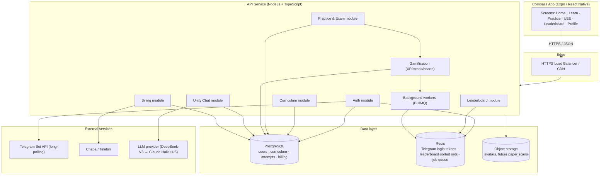
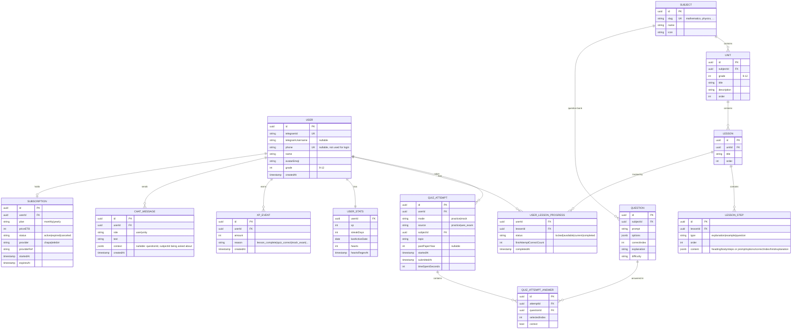
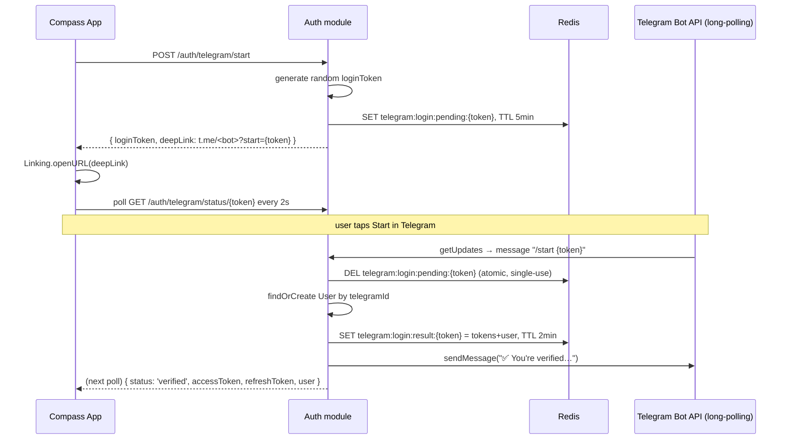

# Compass Backend Architecture

**Status:** Backend implemented and wired to the frontend (see `backend/` and `frontend/src/api/`, `frontend/src/hooks/`). This doc is kept as the original design reference; paths below refer to the app, now at `frontend/src/data/*.ts` etc.

**Scope:** API, data model, and infrastructure needed to make Home, Learn, Practice, UEE, Leaderboard, Profile, and Unity chat real, plus Telegram auth and Compass Pro billing.

**Optimized for:** a solo developer, a cost-sensitive product (Compass Pro is priced at 25–250 ETB — call it $0.20–$2/user; the AI tutor's inference budget is capped at **$10/month total**, hard), a projected 10,000–50,000 active users, and a single TypeScript codebase shared in spirit with the RN client.

---

## 1. Guiding constraints

These choices shape everything below — flag if any is wrong:

- **No email/password, ever.** Auth is Telegram-only (phone + SMS OTP was removed — see §5) — login and registration are the same flow, the backend must not require a separate "register" step.
- **Cost-sensitive.** At 25 ETB/month (~$0.20), infra spend per user has to be near-zero. This rules out anything with a meaningful per-request or per-seat cost at MVP scale — Telegram-only auth is partly *because* of this constraint: no SMS gateway bill.
- **TypeScript end-to-end.** The client is TS/RN. Sharing types between client and server (via a shared package or tRPC) removes a whole class of bugs for a small team without a dedicated API-contract process.
- **Ethiopia-specific integrations.** Telegram auth has a real platform constraint (see §5). Payments should go through a local rail (Chapa or Telebirr), not Stripe, since Stripe doesn't settle in ETB.
- **Content changes shouldn't need app releases.** Subjects, units, lessons, and questions currently live in static TS files. They need to move to a database an admin can edit without shipping a new app build.

---

## 2. System overview



**Why this shape:** one API service, not microservices. At this scale, splitting into services buys nothing but ops overhead — the "modules" above are folders in one Node process (NestJS-style modules, or a plain Express/Fastify app organized the same way), so it's a straightforward extraction later if a module genuinely needs to scale independently (Unity Chat, most likely, if LLM latency becomes the bottleneck).

---

## 3. Recommended stack

| Layer | Choice | Why |
|---|---|---|
| Language | TypeScript (Node 20+) | Same language as the client; shared types via a small `@compass/shared-types` package or tRPC. |
| API framework | NestJS, or Fastify if the team prefers less structure | NestJS's modules/guards map cleanly onto the domain split above and give auth guards, DI, and validation pipes for free. |
| Client↔server contract | tRPC (preferred) or REST + Zod-validated DTOs | tRPC gives end-to-end type safety with zero codegen — the RN app calls `trpc.curriculum.getSubjects.useQuery()` and gets real types. REST is the fallback if the team wants a conventional OpenAPI surface (e.g. for a future web admin or third-party integrations). |
| Database | PostgreSQL (managed: Supabase, Neon, or RDS) | The domain is deeply relational (users → attempts → questions → subjects → units), and XP/subscription writes need real transactions. |
| ORM | Prisma | TS-native schema, migrations, and a query builder that matches the data model in §4 almost 1:1. |
| Cache / ephemeral state | Redis (managed: Upstash for low volume) | Telegram login tokens with TTL, leaderboard sorted sets (§7), rate limiting, BullMQ job queue. |
| Background jobs | BullMQ on Redis | Streak-break detection, leaderboard period rollover, subscription-expiry downgrade, notification dispatch. |
| Object storage | Cloudflare R2 or S3 | Avatars now; scanned past-paper PDFs later if `getPaperQuestions` stops being a reused question bank and becomes real historical papers. |
| Hosting | Fly.io or Render for the API; managed Postgres/Redis from the same or a paired provider | Cheap, simple deploys, scale-to-zero options — appropriate for a pre-revenue-scale product. Move to AWS/GCP only when there's a concrete reason (compliance, specific managed service, real traffic). |
| Error tracking | Sentry (free tier covers this stage) | |
| AI provider | Groq (see §9) | Powers Unity generation and content pre-generation/ingestion (§10) — same provider for both, capped at $10/month total via the tiering in §9. |

---

## 4. Data model



Notes on the fields that don't map 1:1 from the mock data:

- **`LESSON_STEP.content` is `jsonb`** rather than three separate tables, because `lessonContent.ts`'s three step shapes (`explanation` / `example` / `question`) are genuinely a tagged union, not three unrelated entities — modeling it as three join tables would add migration overhead for no query benefit at this scale.
- **`Question` is shared** between Practice and UEE Exam Mode. `Question.examYear` (added for the real archive, see §10) is nullable and only set for questions ingested from an actual past paper — `QUIZ_ATTEMPT.pastPaperYear` records which year a given attempt was for regardless of whether that year has real archived questions yet.
- **Leaderboard is deliberately not a table.** `LeaderboardEntry` in the mock data is a read model, not a source of truth — see §7.

---

## 5. Auth: Telegram-only

**Status: implemented.** Phone + SMS OTP (the original design below §5.1) was removed — an SMS gateway is a real recurring cost per message with no free tier that scales to 500k users, while Telegram delivery is free. Telegram is now the sole auth method; `User.telegramId` is required, `User.phone` is optional (kept for a possible future use — e.g. Chapa mobile-money payouts often want one — but nothing reads it for login).



**Why long-polling (`getUpdates`), not a webhook:** a webhook needs a public HTTPS URL registered with Telegram — fine in production, awkward in local dev (would need ngrok/cloudflared just to test signup). Long-polling needs nothing but outbound internet access, works identically in every environment, and at this message volume (login events, not chat) the inefficiency long-polling is usually criticized for doesn't matter.

**Why polling `/auth/telegram/status`, not a websocket/SSE push:** the app has nothing else that needs a persistent connection, so a 2-second poll avoids standing up a whole connection-management layer for one screen.

**Session strategy:** unchanged from the original design — short-lived access token (15 min) + long-lived refresh token (30 days, rotated on use). No separate "login" vs "register" endpoint — the bot handler does a `findOrCreate` by `telegramId`.

**Rate limiting:** max 20 `/auth/telegram/start` calls per IP per hour (Redis `INCR` + `EXPIRE`) — generous, since the real anti-abuse mechanism here is that `loginToken` is a 32-byte random value nobody can guess, not a short human-entered code like the old OTP was.

### 5.1 Original design (superseded, kept for history)

The phone + SMS/Telegram-OTP design that used to live here — 4-digit codes, an SMS gateway, `POST /auth/otp/request` / `POST /auth/otp/verify` — is gone from the code. If SMS ever comes back (e.g. a "recover access without Telegram" path), the cold-message constraint that motivated the original two-option design is still real: a bot can't message a user who hasn't started a chat with it first.

---

## 6. API surface

Organized by the app's own tabs, not by database table — each group below is a Fastify plugin (module) registered in `backend/src/server.ts`; implemented as REST+Zod, not NestJS/tRPC (see §3).

**Auth**
- `POST /auth/telegram/start` — see §5
- `GET /auth/telegram/status/:token` — see §5
- `POST /auth/refresh`

**Curriculum (Learn tab)**
- `GET /subjects` — the 7 subjects with per-user `mastery` computed from `UserLessonProgress`
- `GET /subjects/:id/units?grade=9..12` — matches the grade filter already in `GradeSelector`
- `GET /lessons/:id` — returns ordered `LessonStep[]`, exactly `LessonScreen`'s `steps` shape
- `POST /lessons/:id/progress` — records a step attempt; server computes whether the lesson is now `completed` and emits an `XP_EVENT`

**Practice**
- `GET /practice/questions?subjectId=&count=` — practice mode question pull
- `POST /quiz-attempts` — start an attempt (mode: `practice` | `mock`)
- `PATCH /quiz-attempts/:id/answers` — record one answer
- `POST /quiz-attempts/:id/submit` — finalize, score, emit XP, return the review payload `ResultsScreen` renders

**UEE**
- `GET /uee/years` — replaces the hardcoded 22-year range in `pastPapers.ts`
- `GET /uee/:year/:subjectId/questions` — Study Mode question list
- `POST /uee/:year/:subjectId/exam` — starts a `QUIZ_ATTEMPT` with `source = 'uee_exam'`, reusing the exact `quiz-attempts` flow above (Exam Mode is not a separate engine — see the note in §4)

**Leaderboard**
- `GET /leaderboard?period=weekly|monthly|allTime` — see §7

**Profile / gamification**
- `GET /me` — profile, `UserStats` (XP, streak, hearts, accuracy)
- `PATCH /me` — edit profile
- `GET /me/mistakes` — wrong `QuizAttemptAnswer`s, backing the Mistakes Book screen

**Unity Chat**
- `GET /chat/messages` — history
- `POST /chat/messages` — see §9

**Billing**
- `POST /billing/checkout` — see §11
- `POST /billing/webhook/chapa` — provider callback
- `GET /billing/subscription` — current plan/status for the Profile → Compass Pro screen

---

## 7. Leaderboard: why it's Redis, not a query

`LeaderboardScreen` needs three ranked views (weekly / monthly / all-time) and has to answer "what's my rank" fast. Computing that with `SELECT ... ORDER BY xp DESC` and counting rows on every request doesn't scale past a small user base, and re-deriving it from `XP_EVENT` on read is strictly worse.

Instead, every `XP_EVENT` write does:

```
ZINCRBY leaderboard:alltime            {amount} user:{id}
ZINCRBY leaderboard:month:2026-08      {amount} user:{id}
ZINCRBY leaderboard:week:2026-W33      {amount} user:{id}
```

Reading a leaderboard page is `ZREVRANGE ... WITHSCORES` (O(log N)); a user's own rank is `ZREVRANK` — both are the operations Redis sorted sets exist for. A nightly job archives the previous week's/month's set (for a "last month you were #4" feature later) and lets old period keys expire. `XP_EVENT` in Postgres remains the durable source of truth the sorted sets are derived from, so a Redis flush is a replay, not data loss.

---

## 8. Gamification: XP, streaks, hearts

- **XP** is append-only (`XP_EVENT`), never a direct `UPDATE users SET xp = xp + n` — an event log means "why does this user have 3,120 XP" is always answerable, and it's the same log that feeds §7.
- **Streaks** can't be maintained on write alone — "did the user miss yesterday" is only knowable by checking, not by an action the user took. A daily cron (BullMQ repeatable job, run once past midnight in Addis Ababa time) scans `USER_STATS.lastActiveDate` and resets `streakDays` to 0 for anyone who didn't log an `XP_EVENT` yesterday.
- **Hearts** (`HeartsBadge`, 4/5 in the mock) decrement on a wrong Learn-mode answer and regenerate on a timer — store `heartsRegenAt` and compute hearts-available lazily on read (`min(max, current + elapsed/regenInterval)`) rather than another cron, since it's cheap to compute per-request and avoids a job for every user every N minutes.

---

## 9. Unity — the AI tutor

`POST /chat/messages` does three things before calling the LLM:

1. **Assembles context** — the user's grade, weakest subject (lowest recent accuracy from `QuizAttemptAnswer`), and, if the message came from an "Ask Unity" tap (`FeedbackBanner` in Learn/Practice, or the explanation card in UEE Study Mode), the specific `questionId` and its prompt/explanation. This is what makes Unity's answer about *that* question instead of a generic tutor reply.
2. **Sends a bounded window** — system prompt + last ~10 messages + the context above, not the full history, to keep token cost predictable.
3. **Calls the LLM provider** and persists both the user message and the reply to `CHAT_MESSAGE`.

Given the floating-panel UX (`UnityChatPanel`) already streams a typed reply visually, the API should support **streaming responses** (SSE or chunked) rather than a single blocking call — the panel already has the UI shape for it (message bubbles appended incrementally reads naturally as tokens arrive).

### Provider: Groq (confirmed, 2026-08-15 — supersedes the earlier DeepSeek-V3 → Claude Haiku 4.5 plan below)

The $10/month hard cap and the real target scale (10k–50k active users, not the 500k hypothetical used below) make this a materially different problem than the original worked example assumed — a metered, fast/cheap open-model provider is no longer just the cheaper launch option, it's close to the only option that fits the budget at all. Groq is confirmed as the provider for both content pre-generation (below) and live Tier 3 generation.

The knowledge-base tiering already designed (Tier 0–3, below) is what actually makes the $10 cap viable — it's not a matter of finding a cheap-enough per-token rate, it's that the overwhelming majority of requests must never reach a billable call at all:

- **Tiers 0–2 are free** (ID lookup, Redis cache, `pgvector` retrieval) and structurally can't blow the budget no matter how many users there are.
- **Tier 3 (grounded generation) is the only spend**, and it should be capped in its own right — not folded into a blanket "10 messages/day" cap. A student re-asking a question that's already cached, or one Tier 0/1/2 can already answer, shouldn't burn down the same daily allowance as a genuinely novel query. Track and cap **Tier 3 calls per user per day** specifically (e.g. 5/day free, unlimited on Compass Pro), separately from the (much larger, free) total message allowance.
- **Enforce with the running spend counter, not a static estimate.** `unity:usage:{period}` (already in the knowledge-base design below) should be checked against the $10 monthly ceiling on every Tier 3 call; if usage is trending over budget mid-month, tighten the free-tier Tier 3 cap dynamically rather than finding out after the bill arrives. This is the real backstop — any cost estimate below is for sizing the initial cap, not a guarantee.

**Illustrative sanity check, not a forecast:** at 50,000 MAU, ~30% daily-active, and a generous 20% of active users triggering one genuinely uncached Tier 3 generation on a given day, that's ~3,000 Tier 3 calls/day (~90k/month) at ~300 output tokens each ≈ 27M tokens/month. Staying under $10/month at that volume needs a blended rate under ~$0.37/1M tokens — comfortably inside Groq's pricing for small open models historically, but **verify current pricing at console.groq.com before relying on this** (rates change, and this estimate could be stale by the time it's read). If real usage runs hotter than this, the per-user Tier 3 cap is the lever to pull, not the model choice.

**Implementation consequence:** Groq's API is OpenAI-compatible (chat completions shape), same as the original DeepSeek plan this replaces — not Anthropic's Messages API. The provider-interface recommendation still holds: build the LLM call behind a small interface (`chat(messages, tools) → reply`) so a future provider swap (e.g. upgrading to a larger/pricier model once Compass Pro revenue can absorb it) is a config change, not a rewrite. **Before launch, specifically test the chosen Groq model's function-calling against Unity's actual tool schemas** (`search_questions`/`recommend_next_topic`) — general benchmark quality doesn't guarantee clean tool-call JSON on your specific tools, and this is the most common failure mode for smaller open models.

<details>
<summary>Original plan (superseded, kept for history): DeepSeek-V3 at launch, Claude Haiku 4.5 after 1,000 Pro subscribers</summary>

This is the one module where per-request cost scales directly with usage, unlike everything else in this stack — and at 25–250 ETB pricing, an unmetered or generously-metered free tier can cost more than the whole product earns (worked example: a 500k-free-user, 10-message/day model runs ~$9k/month against ~$2.7k/month of revenue at a 3% conversion rate). Two decisions followed from that:

- **Launch on DeepSeek-V3**, priced roughly an order of magnitude below Claude Haiku per token, to keep free-tier/trial access affordable while the user base — and its real DAU/conversion numbers — are still unknown.
- **Switch to Claude Haiku 4.5 once Compass Pro passes ~1,000 paying subscribers.** At that point subscription revenue can absorb the higher per-token cost, and Haiku buys back the two things DeepSeek is weaker on for this specific use case: more reliable structured tool-calling and stronger built-in safety tuning, which matters more for a product used by grade 9–12 students.

This assumed a much larger free-tier user base (500k) than the confirmed 10k–50k target, which is why the $10/month Groq plan above replaced it rather than just adjusting the numbers.

</details>

Cost control on top of the provider choice: a **daily Tier 3 cap on the free tier** (see above) and unlimited on Compass Pro — which also gives Pro a second concrete benefit beyond content access, and ties directly into §11.

### Knowledge base: storage, retrieval, and pre-generation (2026-08-14)

**The content isn't RAG-shaped, so most of it shouldn't go through RAG.** Lessons and the UEE question bank are a small, tightly-structured curriculum (subject → unit → lesson → step; question → subject/topic), not a large unstructured corpus. In the most common case — a student taps "Ask Unity" on a specific question or lesson step (§9's context-assembly step already captures `questionId`) — the app already knows exactly which content answers the query. That's a primary-key lookup, not a retrieval problem. Genuine semantic search (embeddings + similarity) is reserved for the minority case: free-text questions with no attached ID.

**Storage: PostgreSQL + `pgvector`, not MongoDB, not a dedicated vector DB.**
- Content already lives in Postgres (`Subject`/`Unit`/`Lesson`/`LessonStep`/`Question`, all shipped). Adding `pgvector` for the embedding minority keeps everything in one database — no second system, no sync problem between a content store and the system of record. Supabase and Neon (both already recommended in §3) support `pgvector` natively.
- **MongoDB rejected:** would mean a second database plus a sync mechanism against Postgres (the source of truth for curriculum and progress), and real vector search on Mongo needs Atlas's paid Vector Search tier — no cost or capability advantage over `pgvector`, pure added operational surface for a solo build.
- **A dedicated vector DB (Pinecone/Weaviate/Qdrant Cloud) rejected:** low thousands of vectors, not millions — doesn't need infrastructure beyond an index inside Postgres.

**Tiered retrieval — most requests never reach the LLM:**

| Tier | Trigger | Cost |
|---|---|---|
| 0 — Direct lookup | Message has an attached `questionId`/`stepId` (the common case, per §9 above) | Free — lookup by ID |
| 1 — Response cache | Free-text question matching a previously-seen normalized query | Free — Redis `GET` |
| 2 — Vector retrieval | Free-text question, no cache hit | ~Free — `pgvector` similarity search |
| 3 — Grounded generation | Tier 2 context, no cached answer covers it | The only tier that spends money — LLM call grounded in the Tier 2 chunks, result cached for next time |

The cache compounds favorably over the product's lifetime: as more students ask similar things, the Tier 3 fraction trends toward zero rather than growing with usage.

**Embeddings: computed locally, not through a paid API.** No embedding provider needed — run a small open-source sentence-embedding model (e.g. `bge-small-en-v1.5`) via `@xenova/transformers` (Transformers.js) directly in the Node backend, CPU inference, for both one-time content indexing and live query embedding. This keeps the entire LLM budget allocated to generation, none of it to search.

**Pre-generation is the main cost lever, done once, offline:** batch-generate an `aiExplanation` for every `Question` and `LessonStep`, stored as a plain column, not chat history. Cost model: `(questions + lesson steps) × avg output tokens × price/token`. Even at a generous future scale (5,000 questions + 1,000 lesson steps, ~300 tokens each ≈ 1.8M output tokens), this is a small one-time batch job — confirm against the chosen provider's current pricing before committing to a number, but it's structurally well inside a single-digit-dollar budget on any cheap open-model tier.

**Data model additions (sketch — not implemented; Unity is still Phase 2 per §14):**
- `Question.aiExplanation: String?`, equivalent field on `LessonStep`.
- New `ContentEmbedding { id, sourceType: 'question' | 'lesson_step', sourceId, embedding vector(384), contentHash }` — kept separate from content tables so re-embedding (model upgrade, content edit) never requires a content-table migration.
- `ChatMessage.context: jsonb` (already shipped, unused until Unity is built) already anticipated storing `questionId`/`subjectId` — that's Tier 0's lookup key as-is.
- Redis: `unity:cache:{hash}` for Tier 1, `unity:usage:{period}` for a running spend counter — the tiering above is the primary cost governor; the counter is a backstop, not the main defense.

---

## 10. Content ingestion: scanned past papers & textbooks (2026-08-15)

Confirmed goal (resolves the Phase 3 open question below): real UEE past papers and real curriculum textbooks, both scanned, get converted into actual `Question`/`Lesson`/`LessonStep` rows — not the placeholder "reuse the practice bank for every year" behavior the UEE endpoint shipped with. Implemented in `backend/scripts/ingest/`, as a batch pipeline that never writes to Postgres unnamed/unreviewed:

1. **Extract** (`extractPastPaper.ts` / `extractLesson.ts`) — feeds each scanned page image to a Groq vision model in one call, asking it to both transcribe the page and structure it into the app's exact `Question` or `LessonStep` shape. A worked answer key/solution on the page is transcribed (`explanationSource: "transcribed"`); if the source only shows an answer letter, the model writes an explanation itself (`explanationSource: "generated"`) — this distinction is kept in the output specifically so review attention can be weighted toward the generated ones.
2. **Review (human, required)** — output lands as a JSON file in `scripts/ingest/output/` (gitignored — likely-copyrighted scanned material and not-yet-verified content don't belong in git) with every item defaulted to `reviewed: false`. This is the one place in the whole app where wrong data does direct harm — a mistranscribed answer key teaches a student the wrong answer — so `importReviewed.ts` **refuses to import anything not explicitly flipped to `reviewed: true`** after a human checks it against the source page. Items flagged `confidence: "low"` (unclear scan, cut-off question) or `explanationSource: "generated"` deserve the closest look.
3. **Import** (`importReviewed.ts`) — writes reviewed rows to Postgres. Past-paper questions get tagged with `Question.examYear` (new field, migration `add_question_exam_year`) so `/uee/:year/:subjectId/questions` can serve the *actual* paper for that year instead of a generic pull from the practice bank, falling back to the generic bank only for years that haven't been ingested yet. Lesson imports replace that lesson's steps outright (the mock ones from `seed.ts`, or a previous ingestion pass) — both operations are idempotent, safe to rerun.

**Cost is one-time/batch, decoupled from the 10k–50k MAU number above** — ingestion cost scales with how many pages get scanned, not how many students use the app. It shares the same Groq vision call for both extraction and structuring (no separate OCR step, no separate embedding step), so a full past-paper archive plus the core lesson set is a small one-time job, not an ongoing line item — leaving the $10/month budget available for Tier 3 chat generation in §9.

**Not yet built:** the pipeline requires `GROQ_API_KEY` (get one at console.groq.com) and a directory of page images to point it at — nothing runs until both exist. See `backend/.env.example` for the exact env vars and `backend/scripts/ingest/*.ts` file headers for CLI usage.

---

## 11. Billing: Compass Pro

25 ETB/month, 250 ETB/year (`PremiumScreen`). Neither Stripe nor PayPal settle natively in ETB, so:

- **Chapa** (or Telebirr directly) for checkout — both support Ethiopian mobile money and bank rails.
- `POST /billing/checkout` creates a pending `SUBSCRIPTION` row and returns a redirect URL to the provider's hosted checkout.
- `POST /billing/webhook/chapa` is the source of truth for activation — **never** activate a subscription from the client-side "success" redirect alone, only from the signed server-to-server webhook, and verify the signature on every call.
- Webhook handling must be **idempotent** (providers retry) — key on `providerRef`, upsert rather than insert.
- A daily job flips `status: active → expired` for any `SUBSCRIPTION` past `expiresAt` that didn't renew, which also gates the Unity daily cap and full past-paper archive back down for lapsed users.

---

## 12. Infrastructure & environments

- **Environments:** `dev` (local, Docker Compose for Postgres/Redis), `staging`, `production` — same Prisma schema, seeded differently (`staging`/`dev` seed with the current mock data as a starting fixture).
- **CI:** typecheck + lint + Prisma migration dry-run on every PR; migrations apply on merge to `main` via a deploy step, not manually.
- **Secrets:** provider env vars (Fly/Render secrets), never committed — Telegram bot token, Chapa secret key, Groq API key (used by both §9 and the §10 ingestion scripts), JWT signing key.
- **Seeding real content:** the 7 subjects × 4 grades × ~5 lessons currently hardcoded in `curriculum.ts` and `lessonContent.ts` become the initial Prisma seed script — this is mechanical (the shapes already match §4 almost exactly) and should be the very first migration, so the app can run against Postgres with zero visible change before any new feature is added. Real content from §10's ingestion pipeline replaces individual lessons/papers on top of this base as they're processed, not all at once.

---

## 13. Security checklist

- `loginToken` is a 32-byte random value, single-use (Redis `DEL` return value gates consumption — see §5), and short-lived (5 min pending / 2 min post-verification) — never logged.
- If `phone` is ever collected later (e.g. for Chapa payouts), treat it as PII the same way the original phone-auth design did: never log it in full, mask to last 4 digits.
- JWT refresh tokens are rotated on every use and revocable (store a `tokenVersion` on `User`, bump it to invalidate all sessions — e.g. on suspected compromise).
- All billing webhooks verify provider signatures; reject unsigned or mismatched requests before touching the database.
- Rate limit `POST /chat/messages` per user in addition to the daily Tier 3 cap, to bound cost from a single abusive session.

---

## 14. Phased rollout

| Phase | Scope | Why this grouping |
|---|---|---|
| **1 — MVP** | Telegram-only auth, curriculum read + seed, Learn progress, Practice + Mock Exams, all-time leaderboard only, Compass Pro checkout | Everything a paying user needs on day one; weekly/monthly leaderboard periods are additive, not blocking. |
| **2** | Weekly/monthly leaderboard periods, Unity chat, push notifications, streak/hearts polish | Needs real usage data (leaderboard periods need users active across weeks; Unity's context assembly benefits from real accuracy history existing). |
| **3** | Admin content authoring (so subjects/units/questions are edited without a migration), analytics dashboard | Scales the *content-editing workflow* once the *product* side is proven — the real past-paper archive itself (§10) doesn't need to wait for this; it's a standalone batch pipeline, already built. |

---

## Resolved (previously open questions)

- **Team size:** solo developer — confirmed 2026-08-15. The Fastify+Zod (not NestJS) call in §3 stands on that basis.
- **Hosting:** greenfield, no existing cloud credits/account — confirmed 2026-08-15. Fly.io/Render recommendation in §3 stands.
- **Chapa vs. Telebirr:** Chapa — confirmed 2026-08-15.
- **Real past papers vs. shared question bank:** confirmed 2026-08-15 — real scanned past papers and real textbook-sourced lessons are the goal, not the placeholder shared bank. Built in §10.
