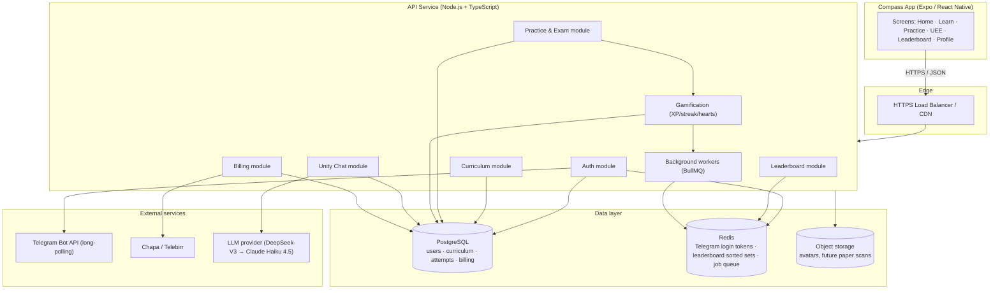
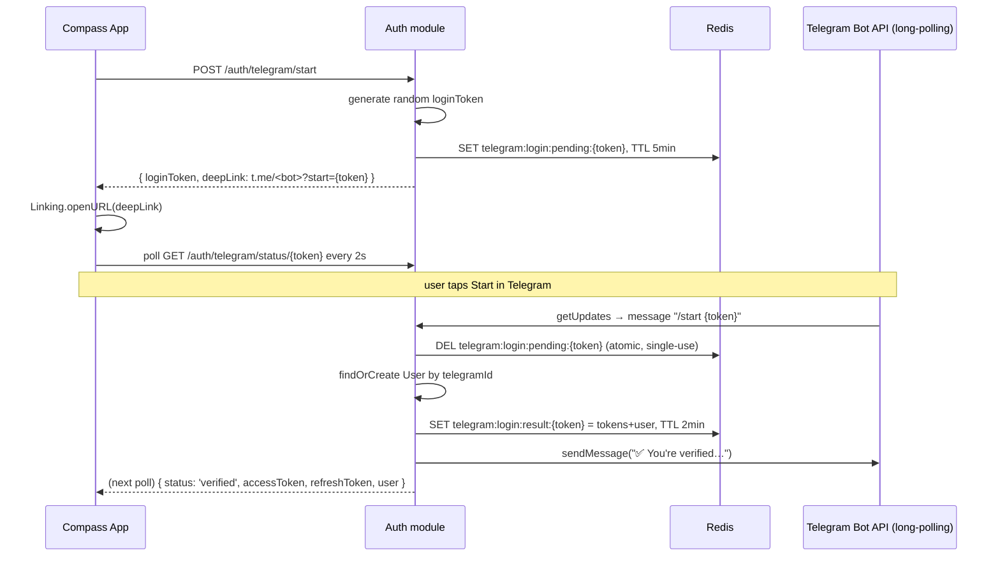

# Compass Backend Architecture

**Status:** Backend implemented and wired to the frontend (see `backend/` and `frontend/src/api/`, `frontend/src/hooks/`). This doc is kept as the original design reference; paths below refer to the app, now at `frontend/src/data/*.ts` etc.

**Scope:** API, data model, and infrastructure needed to make Home, Learn, Practice, UEE, Leaderboard, Profile, and Unity chat real, plus Telegram auth and Compass Pro billing.

**Optimized for:** a small team (1–3 engineers), a cost-sensitive product (Compass Pro is priced at 25–250 ETB — call it $0.20–$2/user), and a single TypeScript codebase shared in spirit with the RN client.

---

## 1. Guiding constraints

These choices shape everything below — flag if any is wrong:

- **No email/password, ever.** Auth is Telegram-only (phone + SMS OTP was removed — see §5) — login and registration are the same flow, the backend must not require a separate "register" step.
- **Cost-sensitive.** At 25 ETB/month (~$0.20), infra spend per user has to be near-zero. This rules out anything with a meaningful per-request or per-seat cost at MVP scale — Telegram-only auth is partly *because* of this constraint: no SMS gateway bill.
- **TypeScript end-to-end.** The client is TS/RN. Sharing types between client and server (via a shared package or tRPC) removes a whole class of bugs for a small team without a dedicated API-contract process.
- **Ethiopia-specific integrations.** Telegram auth has a real platform constraint (see §5). Payments should go through a local rail (Chapa or Telebirr), not Stripe, since Stripe doesn't settle in ETB.
- **Content changes shouldn't need app releases.** Subjects, units, lessons, and questions currently live in static TS files. They need to move to a database an admin can edit without shipping a new app build.

---

## 2. System overview



**Why this shape:** one API service, not microservices. At this scale, splitting into services buys nothing but ops overhead — the "modules" above are folders in one Node process (NestJS-style modules, or a plain Express/Fastify app organized the same way), so it's a straightforward extraction later if a module genuinely needs to scale independently (Unity Chat, most likely, if LLM latency becomes the bottleneck).

---

## 3. Recommended stack

| Layer | Choice | Why |
|---|---|---|
| Language | TypeScript (Node 20+) | Same language as the client; shared types via a small `@compass/shared-types` package or tRPC. |
| API framework | NestJS, or Fastify if the team prefers less structure | NestJS's modules/guards map cleanly onto the domain split above and give auth guards, DI, and validation pipes for free. |
| Client↔server contract | tRPC (preferred) or REST + Zod-validated DTOs | tRPC gives end-to-end type safety with zero codegen — the RN app calls `trpc.curriculum.getSubjects.useQuery()` and gets real types. REST is the fallback if the team wants a conventional OpenAPI surface (e.g. for a future web admin or third-party integrations). |
| Database | PostgreSQL (managed: Supabase, Neon, or RDS) | The domain is deeply relational (users → attempts → questions → subjects → units), and XP/subscription writes need real transactions. |
| ORM | Prisma | TS-native schema, migrations, and a query builder that matches the data model in §4 almost 1:1. |
| Cache / ephemeral state | Redis (managed: Upstash for low volume) | Telegram login tokens with TTL, leaderboard sorted sets (§7), rate limiting, BullMQ job queue. |
| Background jobs | BullMQ on Redis | Streak-break detection, leaderboard period rollover, subscription-expiry downgrade, notification dispatch. |
| Object storage | Cloudflare R2 or S3 | Avatars now; scanned past-paper PDFs later if `getPaperQuestions` stops being a reused question bank and becomes real historical papers. |
| Hosting | Fly.io or Render for the API; managed Postgres/Redis from the same or a paired provider | Cheap, simple deploys, scale-to-zero options — appropriate for a pre-revenue-scale product. Move to AWS/GCP only when there's a concrete reason (compliance, specific managed service, real traffic). |
| Error tracking | Sentry (free tier covers this stage) | |
| AI provider | DeepSeek-V3 at launch → Claude Haiku 4.5 after 1,000 Pro subscribers | Powers Unity — see §9 for the switch criteria and why it's a config change, not a rewrite. |

---

## 4. Data model


Notes on the fields that don't map 1:1 from the mock data:

- **`LESSON_STEP.content` is `jsonb`** rather than three separate tables, because `lessonContent.ts`'s three step shapes (`explanation` / `example` / `question`) are genuinely a tagged union, not three unrelated entities — modeling it as three join tables would add migration overhead for no query benefit at this scale.
- **`Question` is shared** between Practice and UEE Exam Mode, matching `pastPapers.ts` today (`getPaperQuestions` literally reuses `getPracticeQuestions`). `QUIZ_ATTEMPT.pastPaperYear` is nullable and only set when `source = 'uee_exam'`, so a real, distinct past-paper archive can be layered in later (see §11) without a schema change — just start populating `pastPaperYear`-scoped questions.
- **Leaderboard is deliberately not a table.** `LeaderboardEntry` in the mock data is a read model, not a source of truth — see §7.

---

## 5. Auth: Telegram-only

**Status: implemented.** Phone + SMS OTP (the original design below §5.1) was removed — an SMS gateway is a real recurring cost per message with no free tier that scales to 500k users, while Telegram delivery is free. Telegram is now the sole auth method; `User.telegramId` is required, `User.phone` is optional (kept for a possible future use — e.g. Chapa mobile-money payouts often want one — but nothing reads it for login).



**Why long-polling (`getUpdates`), not a webhook:** a webhook needs a public HTTPS URL registered with Telegram — fine in production, awkward in local dev (would need ngrok/cloudflared just to test signup). Long-polling needs nothing but outbound internet access, works identically in every environment, and at this message volume (login events, not chat) the inefficiency long-polling is usually criticized for doesn't matter.

**Why polling `/auth/telegram/status`, not a websocket/SSE push:** the app has nothing else that needs a persistent connection, so a 2-second poll avoids standing up a whole connection-management layer for one screen.

**Session strategy:** unchanged from the original design — short-lived access token (15 min) + long-lived refresh token (30 days, rotated on use). No separate "login" vs "register" endpoint — the bot handler does a `findOrCreate` by `telegramId`.

**Rate limiting:** max 20 `/auth/telegram/start` calls per IP per hour (Redis `INCR` + `EXPIRE`) — generous, since the real anti-abuse mechanism here is that `loginToken` is a 32-byte random value nobody can guess, not a short human-entered code like the old OTP was.

### 5.1 Original design (superseded, kept for history)

The phone + SMS/Telegram-OTP design that used to live here — 4-digit codes, an SMS gateway, `POST /auth/otp/request` / `POST /auth/otp/verify` — is gone from the code. If SMS ever comes back (e.g. a "recover access without Telegram" path), the cold-message constraint that motivated the original two-option design is still real: a bot can't message a user who hasn't started a chat with it first.

---

## 6. API surface

Organized by the app's own tabs, not by database table — each group below is a Fastify plugin (module) registered in `backend/src/server.ts`; implemented as REST+Zod, not NestJS/tRPC (see §3).

**Auth**
- `POST /auth/telegram/start` — see §5
- `GET /auth/telegram/status/:token` — see §5
- `POST /auth/refresh`

**Curriculum (Learn tab)**
- `GET /subjects` — the 7 subjects with per-user `mastery` computed from `UserLessonProgress`
- `GET /subjects/:id/units?grade=9..12` — matches the grade filter already in `GradeSelector`
- `GET /lessons/:id` — returns ordered `LessonStep[]`, exactly `LessonScreen`'s `steps` shape
- `POST /lessons/:id/progress` — records a step attempt; server computes whether the lesson is now `completed` and emits an `XP_EVENT`

**Practice**
- `GET /practice/questions?subjectId=&count=` — practice mode question pull
- `POST /quiz-attempts` — start an attempt (mode: `practice` | `mock`)
- `PATCH /quiz-attempts/:id/answers` — record one answer
- `POST /quiz-attempts/:id/submit` — finalize, score, emit XP, return the review payload `ResultsScreen` renders

**UEE**
- `GET /uee/years` — replaces the hardcoded 22-year range in `pastPapers.ts`
- `GET /uee/:year/:subjectId/questions` — Study Mode question list
- `POST /uee/:year/:subjectId/exam` — starts a `QUIZ_ATTEMPT` with `source = 'uee_exam'`, reusing the exact `quiz-attempts` flow above (Exam Mode is not a separate engine — see the note in §4)

**Leaderboard**
- `GET /leaderboard?period=weekly|monthly|allTime` — see §7

**Profile / gamification**
- `GET /me` — profile, `UserStats` (XP, streak, hearts, accuracy)
- `PATCH /me` — edit profile
- `GET /me/mistakes` — wrong `QuizAttemptAnswer`s, backing the Mistakes Book screen

**Unity Chat**
- `GET /chat/messages` — history
- `POST /chat/messages` — see §9

**Billing**
- `POST /billing/checkout` — see §10
- `POST /billing/webhook/chapa` — provider callback
- `GET /billing/subscription` — current plan/status for the Profile → Compass Pro screen

---

## 7. Leaderboard: why it's Redis, not a query

`LeaderboardScreen` needs three ranked views (weekly / monthly / all-time) and has to answer "what's my rank" fast. Computing that with `SELECT ... ORDER BY xp DESC` and counting rows on every request doesn't scale past a small user base, and re-deriving it from `XP_EVENT` on read is strictly worse.

Instead, every `XP_EVENT` write does:

```
ZINCRBY leaderboard:alltime            {amount} user:{id}
ZINCRBY leaderboard:month:2026-08      {amount} user:{id}
ZINCRBY leaderboard:week:2026-W33      {amount} user:{id}
```

Reading a leaderboard page is `ZREVRANGE ... WITHSCORES` (O(log N)); a user's own rank is `ZREVRANK` — both are the operations Redis sorted sets exist for. A nightly job archives the previous week's/month's set (for a "last month you were #4" feature later) and lets old period keys expire. `XP_EVENT` in Postgres remains the durable source of truth the sorted sets are derived from, so a Redis flush is a replay, not data loss.

---

## 8. Gamification: XP, streaks, hearts

- **XP** is append-only (`XP_EVENT`), never a direct `UPDATE users SET xp = xp + n` — an event log means "why does this user have 3,120 XP" is always answerable, and it's the same log that feeds §7.
- **Streaks** can't be maintained on write alone — "did the user miss yesterday" is only knowable by checking, not by an action the user took. A daily cron (BullMQ repeatable job, run once past midnight in Addis Ababa time) scans `USER_STATS.lastActiveDate` and resets `streakDays` to 0 for anyone who didn't log an `XP_EVENT` yesterday.
- **Hearts** (`HeartsBadge`, 4/5 in the mock) decrement on a wrong Learn-mode answer and regenerate on a timer — store `heartsRegenAt` and compute hearts-available lazily on read (`min(max, current + elapsed/regenInterval)`) rather than another cron, since it's cheap to compute per-request and avoids a job for every user every N minutes.

---

## 9. Unity — the AI tutor

`POST /chat/messages` does three things before calling the LLM:

1. **Assembles context** — the user's grade, weakest subject (lowest recent accuracy from `QuizAttemptAnswer`), and, if the message came from an "Ask Unity" tap (`FeedbackBanner` in Learn/Practice, or the explanation card in UEE Study Mode), the specific `questionId` and its prompt/explanation. This is what makes Unity's answer about *that* question instead of a generic tutor reply.
2. **Sends a bounded window** — system prompt + last ~10 messages + the context above, not the full history, to keep token cost predictable.
3. **Calls the LLM provider** and persists both the user message and the reply to `CHAT_MESSAGE`.

Given the floating-panel UX (`UnityChatPanel`) already streams a typed reply visually, the API should support **streaming responses** (SSE or chunked) rather than a single blocking call — the panel already has the UI shape for it (message bubbles appended incrementally reads naturally as tokens arrive).

### Provider: DeepSeek-V3 at launch, Claude Haiku 4.5 after 1,000 Pro subscribers

This is the one module where per-request cost scales directly with usage, unlike everything else in this stack — and at 25–250 ETB pricing, an unmetered or generously-metered free tier can cost more than the whole product earns (worked example: a 500k-free-user, 10-message/day model runs ~$9k/month against ~$2.7k/month of revenue at a 3% conversion rate). Two decisions follow from that:

- **Launch on DeepSeek-V3**, priced roughly an order of magnitude below Claude Haiku per token, to keep free-tier/trial access affordable while the user base — and its real DAU/conversion numbers — are still unknown.
- **Switch to Claude Haiku 4.5 once Compass Pro passes ~1,000 paying subscribers.** At that point subscription revenue can absorb the higher per-token cost, and Haiku buys back the two things DeepSeek is weaker on for this specific use case: more reliable structured tool-calling (Unity's `search_questions`/`recommend_next_topic` tools need clean, schema-valid calls — this is the most common failure mode for non-frontier models) and stronger built-in safety tuning, which matters more for a product used by grade 9–12 students.

**Implementation consequence:** DeepSeek's API is OpenAI-compatible (chat completions shape), not Anthropic's Messages API — a genuinely different request/response format, not just a model-ID string. Build the LLM call behind a small provider interface (`chat(messages, tools) → reply`) from day one, with a DeepSeek implementation now and a Claude implementation added later, selected by a single config value. That keeps the eventual switch a deploy-time flag, not a rewrite of the chat module. **Before launch, specifically test DeepSeek-V3's function-calling against Unity's actual tool schemas** — general benchmark quality doesn't guarantee clean tool-call JSON on your specific tools.

Cost control on top of the provider choice: recommend a **daily message cap on the free tier** (e.g. 10 messages/day) and unlimited on Compass Pro — which also gives Pro a second concrete benefit beyond content access, and ties directly into §10. Re-check this cap against real usage data once you have it; the number above was sized for planning, not measured.

---

## 10. Billing: Compass Pro

25 ETB/month, 250 ETB/year (`PremiumScreen`). Neither Stripe nor PayPal settle natively in ETB, so:

- **Chapa** (or Telebirr directly) for checkout — both support Ethiopian mobile money and bank rails.
- `POST /billing/checkout` creates a pending `SUBSCRIPTION` row and returns a redirect URL to the provider's hosted checkout.
- `POST /billing/webhook/chapa` is the source of truth for activation — **never** activate a subscription from the client-side "success" redirect alone, only from the signed server-to-server webhook, and verify the signature on every call.
- Webhook handling must be **idempotent** (providers retry) — key on `providerRef`, upsert rather than insert.
- A daily job flips `status: active → expired` for any `SUBSCRIPTION` past `expiresAt` that didn't renew, which also gates the Unity daily cap and full past-paper archive back down for lapsed users.

---

## 11. Infrastructure & environments

- **Environments:** `dev` (local, Docker Compose for Postgres/Redis), `staging`, `production` — same Prisma schema, seeded differently (`staging`/`dev` seed with the current mock data as a starting fixture).
- **CI:** typecheck + lint + Prisma migration dry-run on every PR; migrations apply on merge to `main` via a deploy step, not manually.
- **Secrets:** provider env vars (Fly/Render secrets), never committed — Telegram bot token, Chapa secret key, DeepSeek API key (Anthropic API key added later at the §9 provider switch), JWT signing key.
- **Seeding real content:** the 7 subjects × 4 grades × ~5 lessons currently hardcoded in `curriculum.ts` and `lessonContent.ts` become the initial Prisma seed script — this is mechanical (the shapes already match §4 almost exactly) and should be the very first migration, so the app can run against Postgres with zero visible change before any new feature is added.

---

## 12. Security checklist

- `loginToken` is a 32-byte random value, single-use (Redis `DEL` return value gates consumption — see §5), and short-lived (5 min pending / 2 min post-verification) — never logged.
- If `phone` is ever collected later (e.g. for Chapa payouts), treat it as PII the same way the original phone-auth design did: never log it in full, mask to last 4 digits.
- JWT refresh tokens are rotated on every use and revocable (store a `tokenVersion` on `User`, bump it to invalidate all sessions — e.g. on suspected compromise).
- All billing webhooks verify provider signatures; reject unsigned or mismatched requests before touching the database.
- Rate limit `POST /chat/messages` per user in addition to the daily cap, to bound cost from a single abusive session.

---

## 13. Phased rollout

| Phase | Scope | Why this grouping |
|---|---|---|
| **1 — MVP** | Telegram-only auth, curriculum read + seed, Learn progress, Practice + Mock Exams, all-time leaderboard only, Compass Pro checkout | Everything a paying user needs on day one; weekly/monthly leaderboard periods are additive, not blocking. |
| **2** | Weekly/monthly leaderboard periods, Unity chat, push notifications, streak/hearts polish | Needs real usage data (leaderboard periods need users active across weeks; Unity's context assembly benefits from real accuracy history existing). |
| **3** | Admin content authoring (so subjects/units/questions are edited without a migration), analytics dashboard, real historical past-paper archive (replacing the current shared question-bank reuse in `getPaperQuestions`) | Scales the *content* side once the *product* side is proven. |

---

## Open questions for you

- **Team size / who's building this** — solo, or is there a backend engineer joining? Affects how much I'd lean toward NestJS's structure vs. a lighter Fastify setup.
- **Hosting preference** — any existing AWS/GCP credits or account, or greenfield choice (Fly.io/Render as recommended)?
- **Chapa vs. Telebirr directly** — Chapa is faster to integrate (one API, multiple rails behind it); direct Telebirr integration is more work but no aggregator cut. Worth deciding before §10 gets built.
- **Real past papers vs. the current shared question bank** — Phase 3 assumes you eventually want actual historical UEE papers scanned/transcribed per year. Confirm that's the goal before investing in it.
